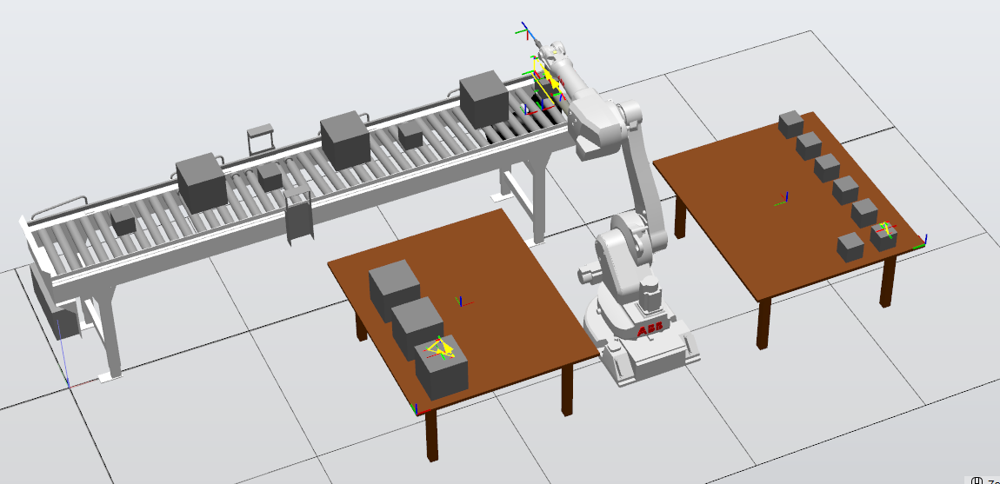

# RobotStudio Sorting Cell

RobotStudio project for an automated sorting cell with a conveyor belt,
vacuum gripper, and marker tool.



## Project overview

This university group project simulates a robot that identifies two box sizes
on a conveyor belt:

- Small boxes are placed on one table.
- Large boxes are placed on another table.
- After placing a small box, the robot uses a marker tool to draw a line on
  its top surface.

The cell was developed in RobotStudio using ABB RAPID programming and
simulated handling and processing operations.

## Included files

- [RobotStudio project](project/robot-studio-project.rspag)
- [3D result visualization](project/robot-studio-visualization.glb)
- [Simulation screenshot](media/robot-studio-simulation.png)

## Repository structure

```text
project/    RobotStudio project and 3D visualization
media/      Simulation images
```

The assignment instructions are not included in this repository.
